---

## About Me / 关于我

- **Currently** Founder & President of the Rutgers Chinese Finance Club and Global Business Lead at Tutturo LLC
- **Studying** Finance and Computer Science at Rutgers University *(B.S., expected May 2029)*
- **Learning** Equity Research & Valuation, AI Tool Integration, and Full-Stack Development
- **Looking to collaborate** on open-source hardware (like my [Magic Glove](https://github.com/LucasYanzy/Magic-Glove) project) and AI-driven applications
- **Ask me about** TMT hardware equity research, Python, Java, C++ (Vibe Coding), and hardware integration with Arduino
- **Reach me** at [LucasYanzy@outlook.com](mailto:LucasYanzy@outlook.com) or on [LinkedIn](https://www.linkedin.com/in/lucasyanzy/)
- **Fun fact:** I launched a student-led conservation project with the Yunnan DianChi Lake foundation and led a biodiversity study across 20 wetland zones in Kunming

## Tech Stack / 技术栈

**Languages**

**Tools & Technologies**

Finance: three-statement modeling, DCF valuation, comparable company analysis, equity research. Also: AI tools and prompt engineering, Office 365 (Excel, PowerPoint, Word). English (fluent), Mandarin (native). C++, JavaScript, HTML and CSS are written in a Vibe Coding workflow.

## Experience & Leadership / 经历

- **Equity Research Intern, TMT Hardware** · Guolian Minsheng Securities &nbsp; `Jun 2026 → Aug 2026` 
  AI data center power-demand forecasting, server BOM cost breakdowns, channel checks, and drafting research reports and valuation models.
- **Founder & President** · Rutgers Chinese Finance Club &nbsp; `May 2026 → Present` 
  Founded a 50+ member student organization connecting members with finance industry knowledge, networking and career resources.
- **Global Business Lead** · Tutturo LLC &nbsp; `Oct 2025 → Present` 
  Early-stage startup: global operations, brand design and corporate website. 8th place at the Rutgers Sharktank competition.
- **Core Project Manager** · Rutgers CSSA &nbsp; `Aug 2025 → Present` 
  Planning department: event logistics, redesigned competition framework and judging process.
- **Hardware Developer** · 2026 IEEE × RUHART Build-a-thon &nbsp; `Apr 2026` 
  Best Productivity/Automation Challenge Prize among ~30 teams. Built [Magic Glove](https://github.com/LucasYanzy/Magic-Glove), an Arduino-based wearable controller that turns hand movements into mouse and keyboard commands.
- **Founder & Project Manager, Student Environmental Project** · Yunnan DianChi Lake Protection & Improvement Foundation &nbsp; `May 2020 → Jun 2025` 
  Student-led conservation project with the foundation: 56 volunteers, 5,000+ community members reached, biodiversity study across 20 wetland zones.
- **Industry Programs** · Goldman Sachs, EY &nbsp; `Apr 2026 → Jul 2026` 
  Goldman Sachs 2026 Possibilities Series (Apr to May); EY CHARGE 2026 (May to Jul).

## AI Coding Usage / AI 编程用量

  

## GitHub Stats / 动态

  
  

  

## Contributions / 贡献

  <picture>
    <source media="(prefers-color-scheme: dark)" srcset="https://raw.githubusercontent.com/LucasYanzy/Lucasyanzy/output/github-snake-dark.svg" />
    <source media="(prefers-color-scheme: light)" srcset="https://raw.githubusercontent.com/LucasYanzy/Lucasyanzy/output/github-snake.svg" />
    
  </picture>

  

Special thanks to the developers of these widgets: <a href="https://github.com/anuraghazra">@anuraghazra</a> (github-readme-stats), <a href="https://github.com/DenverCoder1">@DenverCoder1</a> (streak-stats &amp; typing-svg)

